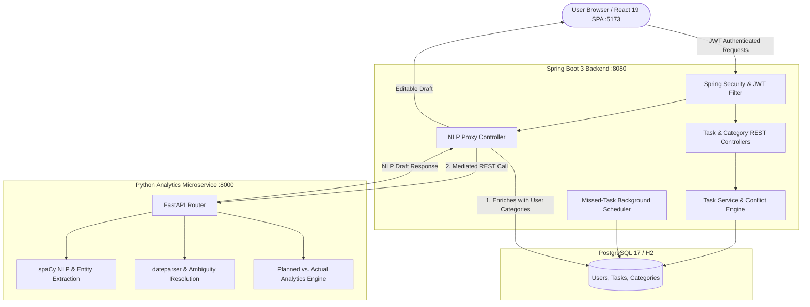

# Circadia (24-Hour Visualizer)

> **An intelligent 24-hour visual day planner, NLP task automation engine, and productivity analytics platform.**
> Built as a production-grade full-stack polyglot application demonstrating **Java (Spring Boot 3)**, **Python (FastAPI & spaCy NLP)**, **React 19**, **PostgreSQL**, **Docker**, and **Microservice Architecture**.

[](https://github.com/palak0991/24-hour-visualizer/actions/workflows/ci.yml)


---

## ✨ Key Features

| Feature | Description |
|---|---|
| **✨ Natural Language Task Creation** | Type conversational phrases (e.g. *"Study DBMS for two hours tomorrow morning"*, *"Complete my Java assignment today from 4 PM to 5:30 PM"*) to auto-generate structured, validated task drafts via spaCy & dateparser. |
| **🛡️ Zero-Hallucination Category Matching** | NLP parser strictly isolates and fuzzy-matches against the authenticated user's active categories without inventing false tags. |
| **🔍 Ambiguity & Conflict Detection** | Identifies vague times (e.g. *"morning"*) and prompts clarifications; automatically flags contradictions between explicit time intervals and duration. |
| **📈 Advanced Productivity Analytics** | Python analytics engine calculating planned vs. actual execution, overrun vs. underrun distinctions, velocity, category time bars, and hourly heatmaps. |
| **⏱️ Actual Execution Tracking** | Live timestamp stamping (*Start Now*, *Complete Now*, *Reset*) and visual overrun indicators (`isOverrunning`) for ongoing tasks. |
| **🕒 24-Hour Circular Visualizer** | Interactive circular timeline visualizer representing the entire 24-hour day cycle with glowing real-time indicator. |
| **🌙 Midnight-Crossing Tasks** | Tasks spanning midnight (e.g. 11 PM → 7 AM) stored as a single continuous DB record, visually clamped per day in UI. |
| **⏰ Missed Task Detection** | Automated Spring Boot background scheduler scanning and marking overdue `PLANNED` tasks as `MISSED` every 15 minutes. |
| **🔒 Enterprise Security & Isolation** | Stateless JWT authentication (JJWT 0.12), user-isolated database context, and secure Spring Boot mediation preventing direct browser-to-Python exposure. |
| **🌸 Soft Pink Aesthetic UI** | Beautiful blush-rose glassmorphism theme designed with custom CSS3, translucent blurred cards, and smooth micro-interactions. |

---

## 🏗️ Tech Stack

* **Frontend:** React 19, Vite 5.4, React Router v7, Axios (JWT Interceptor), Lucide Icons, Soft Pink Glassmorphism CSS3, Vitest
* **Backend:** Java 17, Spring Boot 3.2.5, Spring Security, Spring Data JPA, Hibernate, JJWT 0.12, Lombok, Maven
* **AI & NLP Microservice:** Python 3.10+, FastAPI, Uvicorn, spaCy (`en_core_web_sm`), dateparser, Pydantic v2, Pytest
* **Database & Persistence:** PostgreSQL 17, H2 In-Memory Database (Zero-Config Dev/Test)
* **DevOps & Architecture:** Docker Multi-stage Builds, Docker Compose, Nginx Reverse Proxy, GitHub Actions CI

---

## 🏛️ System Architecture



---

## 🚀 Quick Start

### Option 1: Run with Docker Compose (Recommended)

```bash
# 1. Clone repository
git clone https://github.com/palak0991/24-hour-visualizer.git
cd 24-hour-visualizer

# 2. Build & run full stack
docker compose up --build
```
* **Frontend**: `http://localhost:5173` (or `http://localhost`)
* **Spring Boot API**: `http://localhost:8080/api`
* **Python Microservice**: `http://localhost:8000/docs`

---

### Option 2: Run Locally (Step-by-Step)

#### 1. Python Analytics & NLP Microservice
```bash
cd python-analytics
python -m pip install -r requirements.txt
python -m spacy download en_core_web_sm
uvicorn app.main:app --host 0.0.0.0 --port 8000 --reload
```
*Health Check*: `http://localhost:8000/health`

#### 2. Spring Boot Backend
```bash
cd backend
# Uses default zero-config in-memory H2 database (or PostgreSQL if active)
mvn spring-boot:run
```
*Backend API*: `http://localhost:8080` | *H2 Console*: `http://localhost:8080/h2-console`

#### 3. React Frontend
```bash
cd frontend
npm install
npm run dev
```
*Web App*: `http://localhost:5173`

---

## 🔌 API Overview

### NLP & Task Automation
| Method | Endpoint | Auth | Description |
|---|---|---|---|
| `POST` | `/api/nlp/parse-task` | JWT | Parses natural language task description into a validated draft with clarification feedback. |
| `POST` | `/api/v1/nlp/parse-task` | Internal | Python microservice direct parsing endpoint. |

### Tasks & Categories
| Method | Endpoint | Auth | Description |
|---|---|---|---|
| `GET` | `/api/tasks?date=YYYY-MM-DD&timezone=UTC` | JWT | Fetch schedule overlapping specified date. |
| `POST` | `/api/tasks` | JWT | Create task with overlap conflict validation. |
| `PUT/DELETE` | `/api/tasks/{id}` | JWT | Edit or delete task. |
| `PATCH` | `/api/tasks/{id}/status` | JWT | Update task lifecycle status (`PLANNED`, `COMPLETED`, etc.). |
| `PATCH` | `/api/tasks/{id}/actual-time` | JWT | Stamp real-time execution (`START`, `COMPLETE`, `RESET`). |
| `GET/POST` | `/api/categories` | JWT | List and create user categories. |

### Analytics & Insights
| Method | Endpoint | Auth | Description |
|---|---|---|---|
| `GET` | `/api/analytics/day?date=YYYY-MM-DD` | JWT | Daily productivity metrics & category breakdown. |
| `POST` | `/api/analytics/detect-missed` | JWT | On-demand scan for overdue tasks. |
| `POST` | `/api/v1/analytics/calculate` | Internal | Python engine for planned vs. actual duration analytics. |

---

## 🧪 Testing & Quality Assurance

The application maintains comprehensive test coverage across unit, integration, and slice tests:

```bash
# Run Spring Boot test suite (30 passing tests)
cd backend
mvn test

# Run Python NLP & Analytics test suite (17 passing tests)
cd python-analytics
python -m pytest tests/ -v

# Run Frontend tests & production build
cd frontend
npm run test
npm run build
```

**Total Test Suite: 47/47 passing tests**
- Spring Boot: `TaskRepositoryTest`, `TaskServiceTest`, `NLPTaskServiceTest`, `PythonAnalyticsServiceTest`, `AnalyticsServiceTest`, `JwtTokenProviderTest`.
- Python: `test_nlp_parser.py` (explicit dates, relative dates, durations, ambiguity flags, category matching, API endpoints), `test_analytics.py` (duration separation, zero division safety, heatmaps).

---

## 📁 Repository Structure

```text
24-hour-visualizer/
├── backend/                        # Spring Boot 3 Java Service
│   ├── src/main/java/com/visualizer/hour24/
│   │   ├── controller/             # Auth, Task, Category, Analytics, NLP Controllers
│   │   ├── service/                # Business logic & Python proxy client
│   │   ├── repository/             # Spring Data JPA repositories
│   │   ├── entity/                 # User, Category, Task entities
│   │   ├── dto/                    # Request / Response DTOs
│   │   ├── security/               # JWT authentication filter & config
│   │   └── scheduler/              # Missed-task background scanner
│   └── src/test/                   # 30 JUnit 5 & Mockito test cases
│
├── python-analytics/               # Python FastAPI Microservice
│   ├── app/
│   │   ├── nlp_parser.py           # spaCy & dateparser NLP parsing engine
│   │   ├── analytics_engine.py     # Planned vs. actual execution analytics
│   │   ├── schemas.py              # Pydantic v2 schemas
│   │   └── main.py                 # FastAPI application routes
│   └── tests/                      # 17 pytest test cases
│
├── frontend/                       # React 19 + Vite SPA
│   ├── src/
│   │   ├── components/             # TaskModal (NLP Quick Create), Timeline, AnalyticsPanel
│   │   ├── pages/                  # Dashboard, Login, Register
│   │   ├── services/               # Axios API clients
│   │   └── styles/                 # Soft Pink Glassmorphism CSS
│   └── package.json
│
├── docker-compose.yml              # Container orchestration
├── Dockerfile                      # Multi-stage production container
└── README.md                       # Project documentation
```

---

## 👤 Author

**Palak**  
GitHub: [@palak0991](https://github.com/palak0991)
